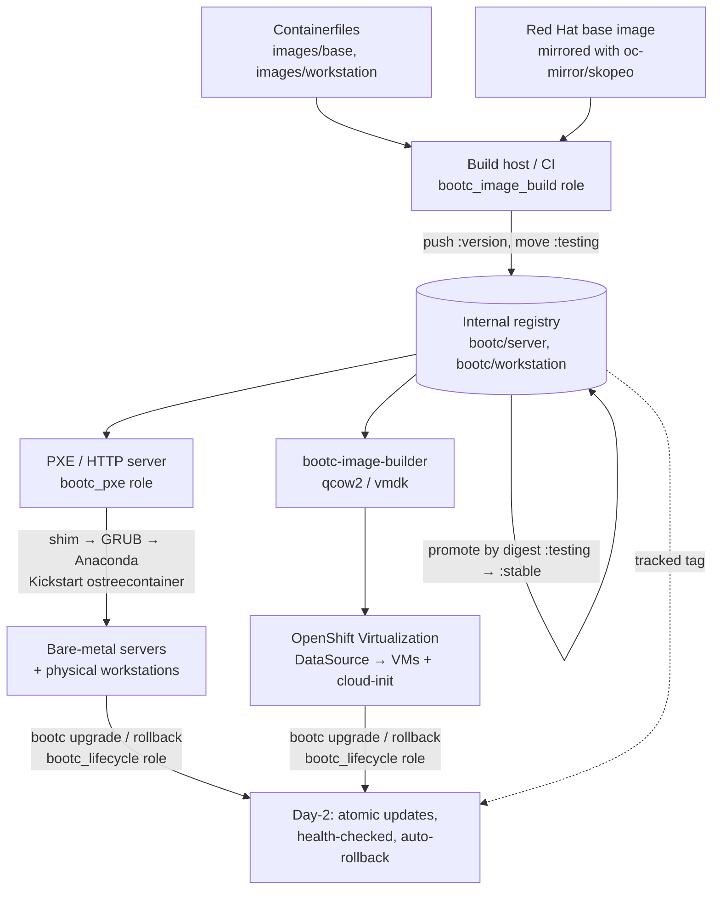

# architecture-bootc-airgap

One RHEL 10 image-mode (`bootc`) OS image, built in CI and stored in the
internal registry, provisioned three ways in an airgapped network:

| Target | How it gets the OS | Day-1 identity | Day-2 |
| --- | --- | --- | --- |
| Physical servers and workstations | PXE / UEFI HTTP Boot → Kickstart `ostreecontainer` (or `bootc`) pulls the image to disk | Kickstart (hostname, admin user, pull secret) | `bootc upgrade` / `bootc rollback` |
| User workstation VMs and server VMs on OpenShift Virtualization (KubeVirt) | `bootc-image-builder` qcow2 → CDI DataVolume → golden DataSource | cloud-init (`cloudInitNoCloud`) | same |
| Other hypervisors (VMware, KVM, Hyper-V) | `bootc-image-builder` vmdk / qcow2 / vhdx | cloud-init | same |



## What's in here

| Path | What it is |
| --- | --- |
| [images/](images/) | `Containerfile`s: **server** (base) and **workstation** (GNOME, `FROM` server), health check with automatic rollback, bootc-image-builder configs, containerDisk wrapper |
| [ansible/roles/bootc_pxe](ansible/roles/bootc_pxe/) | **The main role.** PXE + UEFI HTTP boot server: boot media from the RHEL ISO, Secure Boot shim, GRUB menus with per-MAC zero-touch installs, Kickstarts, registry trust, and DHCP snippets (or proxy / full dnsmasq) |
| [ansible/roles/bootc_image_build](ansible/roles/bootc_image_build/) | Patch → build → RPM diff → push → channel tags. Promote and fleet rollback by digest. VM disks with bootc-image-builder |
| [ansible/roles/bootc_lifecycle](ansible/roles/bootc_lifecycle/) | Day-2: `bootc upgrade` / `switch` / `rollback`, rolling reboots, digest and health verification |
| [ansible/roles/bootc_kubevirt_image](ansible/roles/bootc_kubevirt_image/) | qcow2 → DataVolume → golden DataSource (+ example VM) on OpenShift Virtualization |
| [ansible/playbooks/](ansible/playbooks/) | `pxe_server`, `image_patch`, `image_promote`, `image_disk`, `kubevirt_golden_image`, `day2_{status,upgrade,switch,rollback}` |
| [kubevirt/](kubevirt/) | The same KubeVirt objects as plain YAML, for GitOps |
| [lab/](lab/) | A self-contained **Hyper-V lab** (AlmaLinux 10 standing in for RHEL 10) that runs the whole flow end to end, including the airgap |
| [docs/](docs/) | Architecture, airgap content, bare metal, workstations, KubeVirt, Day-2, migrating from legacy PXE |
| [tools/](tools/) | The tools container (pinned Python 3.14, Ansible, linters, Molecule, pykickstart) and the render check |

## Quick start

Everything runs in the tools container, so nothing needs installing on the host.

```bash
make tools            # build the tools container (ENGINE=docker if you don't have podman)
make check            # yamllint + ansible-lint + render/validate Kickstarts + molecule
make images           # build server + workstation on the AlmaLinux stand-in base
```

Against real infrastructure: copy `ansible/inventory/example/` to
`ansible/inventory/<site>/`, fill in the registry, PXE host, ISO path and hosts,
put the pull secret in `vault.yml`, and run:

```bash
cd ansible
ansible-playbook -i inventory/<site> playbooks/image_patch.yml     # build v1 → :testing
ansible-playbook -i inventory/<site> playbooks/image_promote.yml   # :testing → :stable
ansible-playbook -i inventory/<site> playbooks/pxe_server.yml      # PXE server + DHCP snippets
# PXE-boot a host listed in bootc_pxe_hosts: it installs with no keyboard input
ansible-playbook -i inventory/<site> playbooks/day2_upgrade.yml    # later: patch the fleet
```

To try the whole thing on one Windows PC without touching your network, see
**[lab/README.md](lab/README.md)**.

## Docs

1. [Architecture and decisions](docs/architecture.md)
2. [What to carry into the airgap](docs/airgap-content.md)
3. [Bare metal: PXE, UEFI HTTP Boot, Secure Boot, DHCP](docs/bare-metal-pxe.md)
4. [Workstations (physical and VM)](docs/workstations.md)
5. [OpenShift Virtualization / KubeVirt](docs/kubevirt.md)
6. [Day-2: patch, deploy, roll back](docs/day2.md)
7. [Migrating from the legacy RPM PXE setup](docs/migrating-from-legacy-pxe.md)

## License

[MIT](LICENSE)
